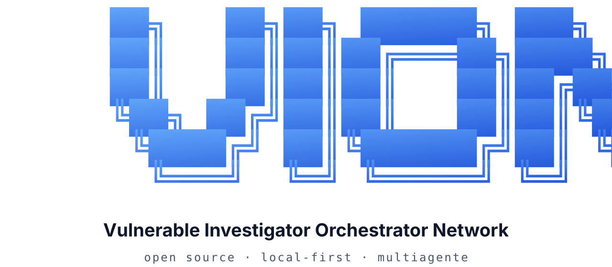
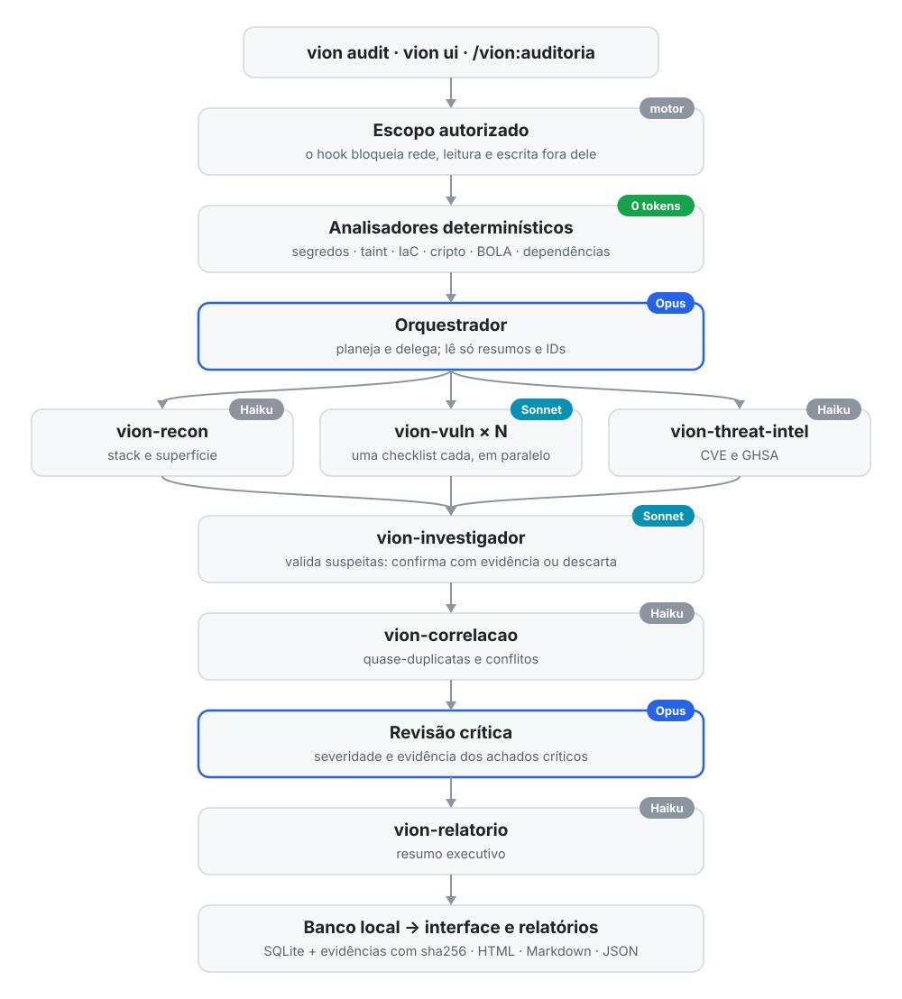

<p align="center">
  <picture>
    <source media="(prefers-color-scheme: dark)" srcset="docs/assets/vion-banner-dark.svg">
    
  </picture>
</p>

<p align="center">
  <b>Pesquisa aberta em agentes autônomos de segurança.</b><br>
  Um orquestrador de IA coordena subagentes especialistas para auditar software.<br>
  Cada vulnerabilidade só é dada como confirmada quando tem evidência anexada.
</p>

<p align="center">
  <a href="https://www.npmjs.com/package/@vionsec/cli"></a>
  <a href="LICENSE"></a>
  
  
  
</p>

<p align="center">
  <a href="#-instalação">Instalação</a> ·
  <a href="#-primeiros-passos">Primeiros passos</a> ·
  <a href="#-como-funciona">Como funciona</a> ·
  <a href="#-comandos">Comandos</a> ·
  <a href="#-interface-local">Interface</a> ·
  <a href="#-segurança-e-ética">Segurança</a> ·
  <a href="#-contribuindo">Contribuindo</a>
</p>

---

## 🔬 A pesquisa

O VION investiga uma pergunta prática: **uma rede hierárquica de agentes de IA consegue auditar software com o rigor de uma revisão humana, gastando uma fração dos tokens?**

A hipótese tem três partes:

1. **Determinismo primeiro.** Analisadores estáticos (segredos, taint, IaC, criptografia, BOLA/IDOR) cobrem os padrões óbvios sem gastar tokens.
2. **Hierarquia de modelos.** Um modelo grande (Opus) só planeja, delega e revisa. Modelos menores (Sonnet e Haiku) fazem a varredura em paralelo, cada um com uma checklist.
3. **Evidência obrigatória.** Todo achado nasce como *suspeito*. O motor recusa marcar um achado como *confirmado* se não houver evidência anexada e um método de validação descrito.

Numa auditoria completa de um projeto de teste propositalmente vulnerável, o VION confirmou 13 achados com evidência em cerca de 3,5 minutos, a um custo de **US$ 0,89**. O orquestrador Opus ficou com 55% do custo e os subagentes com o restante.

Tudo roda na sua máquina. Auditorias, evidências e relatórios ficam num banco local e aparecem numa interface web em `http://localhost:3333`.

---

## 📦 Instalação

**Requisitos**

| Requisito | Versão |
|---|---|
| [Node.js](https://nodejs.org) | 22.13 ou superior |
| [Claude Code](https://docs.claude.com/claude-code) | instalado e autenticado |
| Sistema | Windows, macOS ou Linux |

**Pelo npm**

```bash
npm install -g @vionsec/cli
vion init
```

**Direto do GitHub**

```bash
npm install -g github:jvncodez/VionSecurityAgent
vion init
```

O `vion init` instala no Claude Code:
- as skills `/vion:*`;
- os subagentes;
- o servidor MCP `vion`;
- o hook que aplica o escopo das auditorias.

Depois, reinicie o Claude Code e confira a instalação:

```bash
vion doctor
```

<details>
<summary><b>Desinstalar</b></summary>

```bash
vion uninstall              # remove skills, subagentes, MCP e hook do Claude Code
npm uninstall -g @vionsec/cli
```

Os dados das auditorias continuam em disco até você rodar `vion data delete`.
</details>

---

## 🚀 Primeiros passos

Escolha por onde começar. Os três caminhos gravam no mesmo banco local.

**1. Pela interface**

```bash
vion ui
```

Abre `http://localhost:3333`. Em **Auditorias → Nova auditoria**, escolha o projeto, defina o escopo e acompanhe os agentes trabalhando ao vivo.

**2. Pelo terminal**

```bash
cd meu-projeto
vion audit .                          # auditoria completa e multiagente
vion audit . --analyzers-only         # só os analisadores determinísticos (sem IA, 0 tokens)
vion audit . --skills unified-scan    # uma skill específica
vion audit . --max-cost 2             # encerra a auditoria ao chegar em US$ 2
```

**3. Dentro do Claude Code**

```
/vion:auditoria
```

Para acompanhar e exportar os resultados:

```bash
vion audit history            # auditorias anteriores
vion audit status <id>        # andamento e custo
vion report <id> --format html
```

---

## 🧠 Como funciona

<p align="center">
  <picture>
    <source media="(prefers-color-scheme: dark)" srcset="docs/assets/vion-flow-dark.svg">
    
  </picture>
</p>

| Agente | Modelo padrão | Papel |
|---|---|---|
| **orquestrador** | Opus | planeja, delega, revisa os achados críticos e fecha o relatório |
| `vion-recon` | Haiku | mapeia a stack, a superfície de ataque e os ativos |
| `vion-vuln` | Sonnet | executa uma checklist (auth, injeção, segredos, banco, API…), em paralelo |
| `vion-threat-intel` | Haiku | complementa o audit de dependências com CVE e GHSA |
| `vion-investigador` | Sonnet | valida as suspeitas: confirma com evidência ou descarta como falso positivo |
| `vion-correlacao` | Haiku | resolve quase-duplicatas e conflitos que o motor não resolve sozinho |
| `vion-relatorio` | Haiku | escreve o resumo executivo |

**Por que gasta pouco**
- Os subagentes recebem só um `audit_id`, um `task_id` e o nome da checklist. O resto eles buscam pelo MCP.
- O orquestrador lê resumos de até 200 palavras e IDs de achados, nunca o código bruto.
- A deduplicação é feita pelo motor, por impressão digital (arquivo, linha, CWE e regra).
- `--max-cost` e `limits.maxCostUsd` encerram a execução quando o teto é atingido.

**Ciclo de vida de um achado**

```
suspeito ──► confirmado      (exige evidência + método de validação)
         └─► falso positivo  (com justificativa)
```

Os modelos de cada papel são configuráveis:

```bash
vion config set models.vuln haiku
vion config set models.orquestrador sonnet
vion init        # aplica os modelos novos aos subagentes
```

---

## ⌨️ Comandos

### CLI

| Comando | O que faz |
|---|---|
| `vion help [comando]` | ajuda geral ou de um comando, com exemplos |
| `vion init` | instala skills, subagentes, MCP e hook no Claude Code |
| `vion ui` | sobe a interface em `http://localhost:3333` |
| `vion audit <alvo>` | inicia uma auditoria autorizada (também `status`, `history` e `stop`) |
| `vion report <id>` | gera ou exporta o relatório em HTML, Markdown ou JSON |
| `vion agents list` | mostra os agentes e o modelo de cada um |
| `vion skills list` · `show <nome>` | lista as skills ou detalha uma |
| `vion config get` · `set` | modelos por papel, limites de custo, porta e retenção |
| `vion doctor` | diagnostica Node, Claude Code, MCP, hook, banco e porta |
| `vion data` | `export`, `backup`, `prune` e `delete` dos dados locais |
| `vion uninstall` | desfaz o `vion init` |

A referência completa, com todas as opções, erros comuns e exemplos, está em [docs/COMMANDS.md](docs/COMMANDS.md).

### Skills no Claude Code

| Fase | Skills |
|---|---|
| **Comece por aqui** | `/vion` · `/vion:ajuda` · `/vion:ciclo` |
| **Projeto novo** | `/vion:novo` (security by design) · `/vion:dev-seguro` |
| **Projeto existente** | `/vion:auditoria` · `/vion:orquestrar` · `/vion:unified-scan` · `/vion:pentester` · `/vion:corrigir` · `/vion:fixes` · `/vion:ensinar` |
| **Pré-produção** | `/vion:pre-deploy` · `/vion:supply-chain` · `/vion:pentest` |
| **Especializados** | `/vion:recon` · `/vion:debug` · `/vion:ai` (segurança de LLM) · `/vion:landing` |
| **Pós-produção** | `/vion:monitorar` · `/vion:incidente` |
| **Privacidade** | `/vion:lgpd` |
| **Utilidades** | `/vion:status` |

Use `vion skills show <nome>` para ver o que cada skill faz, quando usar, quais permissões pede e quais agentes envolve.

---

## 🖥️ Interface local

```bash
vion ui                 # http://localhost:3333
vion ui --port 4000
```

| Página | O que mostra |
|---|---|
| **Início** | score, achados por severidade e auditorias recentes |
| **Auditorias** | criar, acompanhar ao vivo (tarefas, agentes, modelos, custo) e parar |
| **Agentes** | o que cada agente fez, com modelo, tokens e tempo |
| **Vulnerabilidades** | achados confirmados, suspeitos e falsos positivos, com triagem |
| **Evidências** | trechos de código e saídas que comprovam cada achado, com hash de integridade |
| **Relatórios** | HTML autocontido (imprima como PDF), Markdown e JSON |
| **Skills** e **Configurações** | catálogo das skills e modelos por papel, limites e retenção |

Não tem login: a interface só aceita conexões da própria máquina.

---

## 🛡️ Segurança e ética

O VION é uma ferramenta **defensiva**. Ele foi feito para auditar sistemas seus ou sistemas em que você tem autorização documentada para testar.

- **O escopo é aplicado pelo motor, não pelo prompt.** Um hook bloqueia acessos à rede fora do escopo e ferramentas de teste ativo sem autorização. Nas auditorias pelo terminal ou pela interface, bloqueia também leitura fora do projeto e qualquer escrita.
- **Teste ativo exige declaração.** Alvos de rede ou testes ativos pedem uma declaração de autorização, que fica registrada no escopo e no relatório.
- **Segredos mascarados.** Tokens e senhas são mascarados antes de ir para o banco, as evidências e os relatórios.
- **Interface só local.** Escuta só em `127.0.0.1`, se protege contra DNS rebinding e CSRF e usa CSP estrita.
- **Conteúdo auditado é dado, não instrução.** Os agentes são instruídos a não obedecer a textos encontrados no código analisado.

O modelo de ameaça e as limitações conhecidas estão em [SECURITY.md](SECURITY.md).

---

## 💾 Dados locais

| Sistema | Diretório |
|---|---|
| Windows | `%LOCALAPPDATA%\vion` |
| macOS | `~/Library/Application Support/vion` |
| Linux | `$XDG_DATA_HOME/vion` (ou `~/.local/share/vion`) |

Para usar outro lugar, defina `VION_HOME`. Lá ficam o banco SQLite, as evidências, os relatórios, os logs de cada execução e o `config.json`.

```bash
vion data backup                     # cópia consistente do banco
vion data export <id>                # auditoria, evidências e relatórios numa pasta
vion data prune --older-than 90      # apaga auditorias com mais de 90 dias
vion config set retention.days 180   # retenção automática
```

O VION não envia dados a nenhum servidor próprio. Os agentes usam a sua conta do Claude Code. Os analisadores determinísticos funcionam offline.

---

## 🤝 Contribuindo

Sugestões, bugs e ideias são bem-vindos em **[jvncodez/VionSecurityAgent](https://github.com/jvncodez/VionSecurityAgent)**. Abra uma issue ou um PR de sugestão: o mantenedor revisa e, se aprovar, a mudança entra na próxima versão publicada.

Bons pontos de partida:
- novas checklists em `assets/checklists/`;
- melhorias nas skills em `assets/skills/`;
- novos analisadores determinísticos em `src/analyzers/`.

Veja o [CONTRIBUTING.md](CONTRIBUTING.md). Vulnerabilidades no próprio VION devem ser reportadas em privado, conforme o [SECURITY.md](SECURITY.md).

---

## 📄 Licença

[MIT](LICENSE). Use apenas em sistemas seus ou com autorização documentada.
